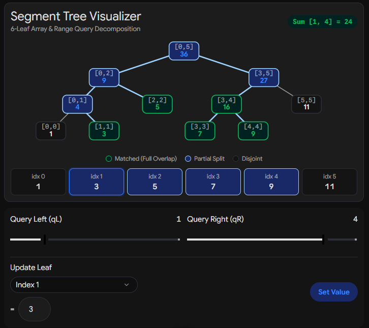

## Intro
A Segment Tree is a data structure designed to perform range queries and element updates on an array in logarithmic time.

It is a higher dimensional (binary tree-based) data structure that resolves the classic trade-off between static range queries and dynamic point updates:

| Operation | Naive Array | Prefix Sums | Segment Tree | 
| -------- | -------- | -------- | -------- |
| **Point Update** arr[i] = x | O(1) | O(n) | O(logn) | 
| **Range Query** ∑i ​arr[i] | O(n) | O(1) | O(logn) | 

Hence, whenever an array undergoes frequent modifications alongside associative range operations (Sum, Min, Max, GCD), a Segment Tree delivers $O(\log n)$ for both.


## 1. Structural Representation


Let the base array be:
$$\text{arr} = [1, 3, 5, 7, 9, 11], \quad n = 6 \quad (\textbf{0-indexed: } 0 \le i \le 5)$$
We construct a Range Sum segment tree. 
Each node represents a range $[L, R]$ and stores $\sum_{i=L}^R \text{arr}[i]$.


* **Root:** Covers $[0, n-1]$.
* **Internal Node:** If a node covers $[L, R]$, its midpoint is $M = \lfloor\frac{L+R}{2}\rfloor$.
* Left child covers $[L, M]$.
* Right child covers $[M+1, R]$.
* **Leaves:** Cover single-element intervals $[i, i]$ (one for every element of the underlying array).

```
                          Node 1: [0, 5]
                            Sum = 36
                            /          \
                           /            \
              Node 2: [0, 2]             Node 3: [3, 5]
                Sum = 9                   Sum = 27
                /      \                  /        \
               /        \                /          \
        Node 4: [0, 1]  Node 5: [2, 2]  Node 6: [3, 4]  Node 7: [5, 5]
            Sum = 4         Sum = 5         Sum = 16        Sum = 11
            /     \         (Leaf)          /      \         (Leaf)
           /       \                       /        \
      Node 8: [0, 0] Node 9: [1, 1]   Node 12: [3, 3] Node 13: [4, 4]
        Sum = 1        Sum = 3           Sum = 7         Sum = 9
         (Leaf)         (Leaf)            (Leaf)          (Leaf)
```
<!-- 
Some nore properties:
- for n elements, there are n leaf nodes and n-1 internal nodes, hence 2n-1 nodes total
-  -->


### 1D Array Storage (Binary Heap Representation):

Nodes are placed in an implicit array tree[] using **1-based indexing**:

For node $u$:
* Left child: $2u$
* Right child: $2u + 1$
* Parent: $\lfloor u / 2 \rfloor$

Hence, final array is like: 
**[Node1, Node2, Node3, Node4, Node5, Node6, Node7, Node8, Node9, _, _, Node12, Node13, _, _]**

### Why $O(4n)$ Memory?

A segment tree for $n$ elements has $n$ leaves and $n - 1$ internal nodes ($2n - 1$ total nodes). When stored implicitly in a 1D array where node $u$ has children at $2u$ and $2u+1$ (1-indexed). Hence, padding is required because the tree is balanced but not always full. 

**Case 1: (Works fine) when n is a power of 2 (say n = 4):**
- The tree will have exactly n (= 4) leaf nodes and n - 1 (= 3) internal nodes, totaling 7 nodes.
- The max index reached using our formula is exactly 7 (2n - 1). No space is wasted.
```
                          Node 1: [0, 3]
                            /          \
              Node 2: [0, 1]             Node 3: [2, 3]
               /        \                /          \
        Node 4: [0, 0]  Node 5: [1,1]  Node 6: [2,2]  Node 7: [3,3]
             (leaf)          (Leaf)          (leaf)          (Leaf)
```

**Case 2: (The Problem) when n is not a power of 2: (say n = 6)**
- If n = 6, the segment tree must expand down an extra level to accommodate the 5th and 6th element. Mathematically, we must round n up to the next highest power of 2:
\(N_{next}=2^{\lceil \log _{2}n\rceil }\)
- For n = 6, the next power of 2 is 8. A perfect binary tree built for 8 elements requires:
\(\text{Total\ Slots}=2\times 8-1=15\text{\ slots}\)
- Because our recursive index formula (2i and 2i + 1) acts as if the tree is perfectly filled out to that next power of 2 level, the index of the last leaf node will approach 15.
- Hence, If we had only allocated 2n space (2 × 6 -1 = 11 slots), accessing index 15 would trigger a segmentation fault / index out of bounds error.
```
                          Node 1: [0, 5]
                           /            \
              Node 2: [0, 2]             Node 3: [3, 5]
               /        \                /          \
        Node 4: [0, 1]  Node 5: [2, 2]  Node 6: [3, 4]  Node 7: [5, 5]
            /     \         (Leaf)          /      \         (Leaf)
      Node 8: [0, 0] Node 9: [1, 1]   Node 12: [3, 3] Node 13: [4, 4]
         (Leaf)         (Leaf)            (Leaf)          (Leaf)
```


**why O(4n):** 
- We can find the maximum possible array index needed by examining the worst-case scenario: when n is just slightly above a power of 2 (e.g., \(n = 2^k + 1\)).
Let's calculate the upper limit for the next power of 2:
\(N_{next}<2n\)
- Since a perfect binary tree of size \(N_{next}\) requires \(2 \times N_{next} - 1\) slots, we substitute the inequality: 
\(\text{Max\ Index}\approx 2\times (2n)-1=4n-1\)
- Hence, requiring an array allocation of $4n$ elements to prevent out-of-bounds indexing.
- In this example: for 6 elements, we need 6 leaf + 5 internal nodes, but in 1-D representation, we need 15 size array. (average case)
```csv
tree Index,"Node Segment [L,R]",Value (Sum),Node Status
1,"[0,5]",36,Root
2,"[0,2]",9,Internal
3,"[3,5]",27,Internal
4,"[0,1]",4,Internal
5,"[2,2]",5,Leaf (arr[2])
6,"[3,4]",16,Internal
7,"[5,5]",11,Leaf (arr[5])
8,"[0,0]",1,Leaf (arr[0])
9,"[1,1]",3,Leaf (arr[1])
"10, 11",Unused,0,Blank padding
12,"[3,3]",7,Leaf (arr[3])
13,"[4,4]",9,Leaf (arr[4])
```


---

## 2. Construction: The $O(n)$ Build Phase

The tree is built recursively bottom-up via post-order traversal:

1. Divide current interval $[L, R]$ at $M = \lfloor (L+R)/2 \rfloor$.
2. Recurse left child: $[L, M]$ into `tree[2 * node]`.
3. Recurse right child: $[M+1, R]$ into `tree[2 * node + 1]`.
4. Merge: `tree[node] = tree[2 * node] + tree[2 * node + 1]`.

```
build(1, [0, 5])
 ├── build(2, [0, 2])
 │    ├── build(4, [0, 1])
 │    │    ├── build(8, [0, 0])  -> leaf: arr[0] = 1
 │    │    ├── build(9, [1, 1])  -> leaf: arr[1] = 3
 │    │    └── tree[4] = 1 + 3 = 4
 │    ├── build(5, [2, 2])       -> leaf: arr[2] = 5
 │    └── tree[2] = 4 + 5 = 9
 ├── build(3, [3, 5])
 │    ├── build(6, [3, 4])
 │    │    ├── build(12, [3, 3]) -> leaf: arr[3] = 7
 │    │    ├── build(13, [4, 4]) -> leaf: arr[4] = 9
 │    │    └── tree[6] = 7 + 9 = 16
 │    ├── build(7, [5, 5])       -> leaf: arr[5] = 11
 │    └── tree[3] = 16 + 11 = 27
 └── tree[1] = 9 + 27 = 36

```

Because each internal node does $O(1)$ merging and there are $2n - 1$ total nodes, the overall build time is $O(n)$.

---

## 3. Range Query: O(logn)

Consider a query for the range $[1, 4]$:


$$\text{Query}([1, 4]) = \text{arr}[1] + \text{arr}[2] + \text{arr}[3] + \text{arr}[4] = 3 + 5 + 7 + 9 = 24$$

### The Overlap Decision Tree

At every node with range $[L, R]$ and target query $[qL, qR]$:

```
                  Does [L, R] intersect [qL, qR]?
                             /      \
                           No        Yes
                          /            \
            Return Identity (0)     Is [L, R] completely inside [qL, qR]?
                                            /                  \
                                          Yes                   No
                                         /                        \
                           Return tree[node]           Split at M = (L+R)/2
                                                       Recurse Left & Right
                                                       Return Left + Right

```


### Execution Trace for $[qL=1, qR=4]$

```
Query(node 1, [0, 5])
 │   [0, 5] partially overlaps [1, 4] -> Split at M = 2
 ├── Query(node 2, [0, 2])
 │    │   [0, 2] partially overlaps [1, 4] -> Split at M = 1
 │    ├── Query(node 4, [0, 1])
 │    │    │   [0, 1] partially overlaps [1, 4] -> Split at M = 0
 │    │    ├── Query(node 8, [0, 0]) -> DISJOINT ([0, 0] not in [1, 4]) -> Returns 0
 │    │    └── Query(node 9, [1, 1]) -> TOTAL OVERLAP ([1, 1] in [1, 4]) -> Returns 3
 │    │    Returns: 0 + 3 = 3
 │    └── Query(node 5, [2, 2])      -> TOTAL OVERLAP ([2, 2] in [1, 4]) -> Returns 5
 │    Returns: 3 + 5 = 8
 └── Query(node 3, [3, 5])
      │   [3, 5] partially overlaps [1, 4] -> Split at M = 4
      ├── Query(node 6, [3, 4])      -> TOTAL OVERLAP ([3, 4] in [1, 4]) -> Returns 16
      └── Query(node 7, [5, 5])      -> DISJOINT ([5, 5] not in [1, 4]) -> Returns 0
      Returns: 16 + 0 = 16

Final Result = 8 + 16 = 24

```

Only **three nodes** directly supplied their stored values:

* Node 9: $[1, 1] \rightarrow 3$
* Node 5: $[2, 2] \rightarrow 5$
* Node 6: $[3, 4] \rightarrow 16$

Summing these gives $3 + 5 + 16 = 24$ in $\le 4 \log n$ operations.

---

## 4. Point Update: O(logn)

Execute update: `update(idx = 2, val = 10)` (replacing $\text{arr}[2] = 5$ with $10$).

This requires traveling straight down to leaf $[2, 2]$ and updating each ancestor on the way back up:

```
Downwards Search Path:
1. Node 1 [0, 5]: idx 2 <= M (2)  -> Go to left child (Node 2)
2. Node 2 [0, 2]: idx 2 > M (1)   -> Go to right child (Node 5)
3. Node 5 [2, 2]: L == R == 2     -> Base case: tree[5] = 10

Upwards Backtracking Path:
1. Node 5 [2, 2] = 10
2. Node 2 [0, 2] = tree[4] + tree[5] = 4 + 10 = 14  (Old: 9)
3. Node 1 [0, 5] = tree[2] + tree[3] = 14 + 27 = 41 (Old: 36)

```

Exactly $\lceil \log_2 n \rceil + 1$ nodes are touched, maintaining $O(\log n)$ runtime.


