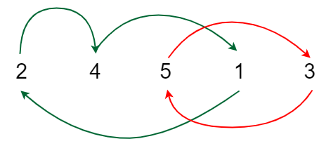

## method 1: (basic) Swapping to Correct Positions - O(n log n) Time and O(n) Space
The idea is to use a hash map to store each element of the given array along with its index. We also create a temporary array that stores all the elements of the input array in sorted order.

As we traverse the input array, if the current element arr[i] is not in its correct position, we swap it with the element that should be at i i.e., temp[i]. After this, we increment the swap count and update the indices in the hash map accordingly.

```python
def minSwaps(arr, temp):
  h = {}
  for i in range(len(arr)):
    h[arr[i]] = i
  
  swaps=0
  for i in range(len(arr)):
    if arr[i]!=temp[i]:
      ind = h[temp[i]] # track this for later use
      # swap idx h[temp[i]] and i in arr
      arr[i], arr[ind] = arr[ind], arr[i]
      # also update the hashmap, used ind here
      h[arr[i]] = i
      h[arr[ind]] = ind
      swaps+=1
  return swaps


a= [8,2,3,4,5,6,7,1] # examples
b= [5,2,3,4,8,6,7,1]
c= [5,3,2,4,8,6,7,1]
d= [8,7,6,5,4,3,2,1]

temp = sorted(a) # sorted array as reference to correct places
print(minSwaps(a, temp))
print(minSwaps(b, temp))
print(minSwaps(c, temp))
print(minSwaps(d, temp))
```

## method 2: (optimal) Cycle Detection - O(n log n) Time and O(n) Space
This approach uses cycle detection method to find out the minimum number of swaps required to sort the array. 

If an element is not in its correct position, it indicates that it is a part of a cycle with one or more other elements that also need to be moved. 

For example, if element A is in the position of element B, and element B is in the position of element C, and so on, until it comes back to A, it forms a cycle. And to sort the elements in the cycle, we need `cycleSize - 1` swaps, as each swap places one element in its correct position, and the last element will automatically be in its correct place.



Theory:
When an array is out of order, elements form closed "cycles" of misplacement. For example, if Element A is in Element B's spot, B is in C's spot, and C is in A's spot, they form a cycle of size 3.
• Formula: To fix any cycle of size K, you need exactly K - 1 swaps.
• Total Swaps: \(\sum (CycleSize - 1)\) for all cycles.

We use a hash map to store the original indices of each element and a visited array to mark elements that have already been included in a cycle. Next, we sort the array. As we traverse it, if an element hasn’t been visited and isn’t in its correct position, we trace the cycle formed by the misplaced elements and find its size. The swap count is then updated by cycleSize - 1.


```python
def minSwaps(arr):
    n = len(arr)
        
    # Array to Keep track of those elements
    # who already been included in the cycle.
    vis = [False] * n
    
    # Hashing elements with their original positions
    pos = {}
    for i in range(len(arr)):
        pos[arr[i]] = i
        
    arr.sort()

    swaps = 0
    for i in range(n):

        # Already a part of another cycle Or
        # in its correct position
        if vis[i] or pos[arr[i]] == i:
            continue

        j, cycleSize = i, 0

        # We make a cycle until it comes
        # back to first element again.
        while not vis[j]:
            vis[j] = True

            # move to next element of the cycle
            j = pos[arr[j]]
            cycleSize += 1

        # Update answer by adding current cycle.
        if cycleSize > 0:
            swaps += (cycleSize - 1)
    return swaps


if __name__ == "__main__":
	arr = [10, 19, 6, 3, 5]
	print(minSwaps(arr))
```


## differences: (method 2 always wins)
```csv
Dimension,Swap-to-Position (Hash Map Simulation),Cycle Decomposition (Graph / Cycle Counting)
Mental Model,Greedy simulation: finds where the target item is and physically performs the swap.,Mathematical property: counts disjoint permutation cycles (swaps=∑(cycle_len−1)).
In-Place Mutation,Mutates the input array in-place (destroys original array order unless explicitly copied).,Read-only on the input array; tracks visited indices using a boolean array.
Code Verbosity & Bookkeeping,High bookkeeping overhead: must synchronize both array indices and hash map values on every swap.,Low bookkeeping: pure iteration and a visited flag array.
Handling Duplicates,Fails / Fragile: A dictionary mapping element -> index breaks if the array contains duplicate values without complex multi-index tracking.,"Adaptable: Works with duplicates by indexing pairs (val, original_idx) during sorting."
Practical Speed / Overhead,"Slower constant factor due to dynamic hash map lookups, hash collisions, and array writes.",Faster constant factor: direct array indexing with contiguous memory reads.
```